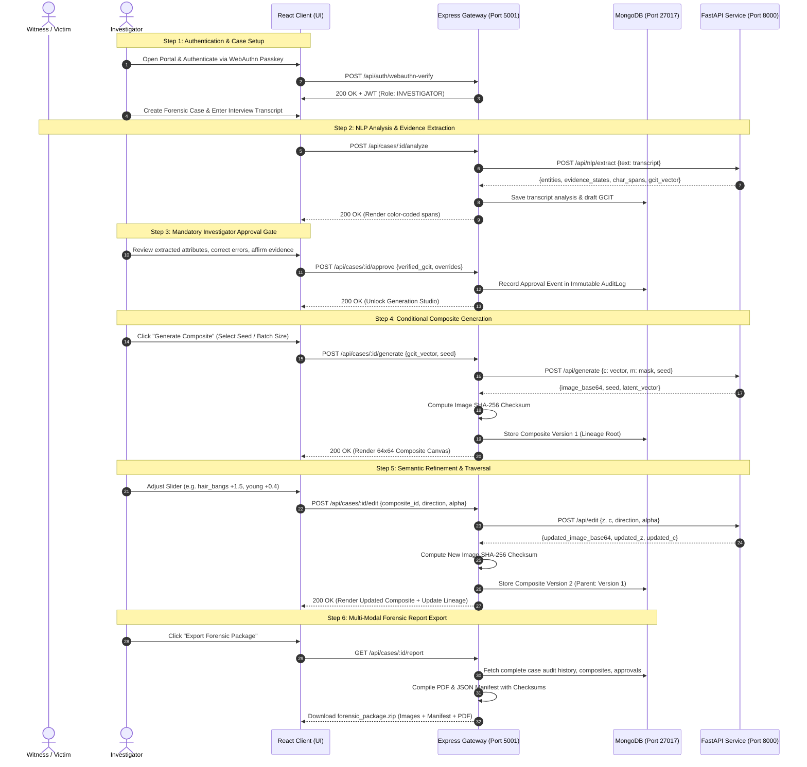

# Phantom AI 3.0 — System Architecture & Component Specification

## 1. High-Level Architecture Overview

Phantom AI 3.0 is structured as a decoupled, multi-tier enterprise forensic application designed for local, air-gapped, or secured on-premises deployment without external cloud API dependencies.

```
+----------------------------------------------------------------------------------------------------+
|                                      PRESENTATION TIER (SPA)                                       |
|  React 19 + TypeScript + Vite + Tailwind CSS                                                       |
|  - Passkey Authentication (WebAuthn / FIDO2)        - Witness Transcript Analysis & Span Viewer    |
|  - Investigator Approval Gate                       - Interactive 64x64 Composite Canvas           |
|  - Dual Semantic Editing Studio                     - Immutable Version Lineage Graph              |
|  - Audit Log Inspector                              - Multi-Modal Forensic Report Generator        |
+----------------------------------------------------------------------------------------------------+
                                                   |
                                            HTTPS / REST (JSON)
                                                   |
                                                   v
+----------------------------------------------------------------------------------------------------+
|                                    APPLICATION & API GATEWAY                                       |
|  Node.js (v20+) + Express 4 + TypeScript (Port 5001)                                               |
|  - WebAuthn Relying Party Service                   - JWT Authentication & RBAC Gatekeeper         |
|  - Case Lifecycle State Machine                     - Investigator Approval Enforcement            |
|  - Cryptographic Audit Logger (SHA-256)             - Forensic Report Packaging Engine             |
|  - Microservice Reverse Proxy / Orchestrator        - Schema Validation & Input Sanitization       |
+----------------------------------------------------------------------------------------------------+
                     |                                                                |
           Mongoose / Wire Protocol                                             HTTP / Internal
                     |                                                                |
                     v                                                                v
+------------------------------------------+     +---------------------------------------------------+
|             PERSISTENCE TIER             |     |              ML INFERENCE TIER                    |
|  MongoDB 7.0 / 8.x (Port 27017)          |     |  Python 3.10-3.13 + FastAPI + PyTorch (Port 8000) |
|  - Users & Passkey Credentials           |     |  - BiLSTM-CRF NLP Extraction Service              |
|  - Cases, Transcripts & Witness Metadata |     |  - Conditional WGAN-GP Synthesis Engine (MPS/CPU) |
|  - Composite Versions & Variations       |     |  - Latent Space & GCIT Semantic Editing Engine    |
|  - Append-Only Tamper-Evident Audit Logs |     |  - Independent Forensic Evaluator Multi-Label CNN |
|  - Rendered Forensic PDF / JSON Manifests|     |  - Checkpoint SHA-256 Runtime Integrity Watchdog  |
+------------------------------------------+     +---------------------------------------------------+
```

---

## 2. Component Breakdown

### 2.1 Presentation Tier (`phantom-ai-client`)
- **Framework & Tooling:** React 19, TypeScript, Vite 5, Tailwind CSS, Lucide React icons.
- **Port:** `5173` (development) / static production build.
- **Key Modules:**
  - `AuthContext` / `Login`: Passwordless authentication utilizing the WebAuthn standard (`@simplewebauthn/browser`) with fallback to local development mock authenticator.
  - `CaseWorkspace`: Central investigator dashboard showing active cases, witness sessions, and case status.
  - `WitnessAnalysis`: Transcript input interface with real-time entity span highlighting, color-coded by evidence polarity (`PRESENT` = Emerald, `ABSENT` = Rose, `UNKNOWN` = Amber, `CONTRADICTORY` = Purple).
  - `ApprovalGate`: Mandatory human-in-the-loop review interface where investigators explicitly verify, override, or approve attribute mappings prior to composite synthesis.
  - `CompositeStudio`: $64 \times 64$ native pixel canvas rendering with interactive nearest-neighbor / bicubic scaling, seed generation, batch variation grid, and side-by-side comparison.
  - `SemanticEditor`: Dual-mode adjustment panel with 5 approved latent traversal sliders ($\pm 3.0$) and continuous GCIT feature sliders ($[-1.0, 1.0]$).
  - `VersionLineage`: Tree and list visualization displaying parent-child composite iterations with SHA-256 commit hashes.
  - `ForensicReportModal`: Document preview showing metadata, chain-of-custody logs, composite images, and download buttons (JSON metadata + print-ready layout).

### 2.2 Application & Security Gateway (`phantom-ai-api`)
- **Runtime:** Node.js (v20+ / v25+), Express 4, TypeScript.
- **Port:** `5001`.
- **Key Subsystems:**
  - **Authentication & WebAuthn RP:** Implements `@simplewebauthn/server` for FIDO2 passkey registration and authentication ceremonies. Issues signed JSON Web Tokens (JWT) upon successful signature verification.
  - **Role-Based Access Control (RBAC):** Hierarchical permissions:
    - `INVESTIGATOR`: Create cases, conduct interviews, approve attributes, generate composites.
    - `LEAD_INVESTIGATOR`: All investigator rights plus seal case, sign off on forensic reports, export court packages.
    - `ADMIN`: User provisioning, security audit log review, system health inspection.
  - **Investigator Gatekeeping:** Middleware blocking `/api/cases/:id/generate` requests unless an investigator approval payload is cryptographically tied to the case.
  - **Audit Logging Subsystem:** Append-only log recording every user action, state change, attribute override, and generation request with timestamps, IP addresses, user IDs, and SHA-256 payload checksums.
  - **Report Packaging:** Compiles case transcripts, attribute audit tables, composite image artifacts, and execution timelines into standardized forensic report packages.

### 2.3 ML Inference Microservice (`phantom-ai-ml`)
- **Runtime:** Python 3.10-3.13, FastAPI, Uvicorn, PyTorch 2.15+ (Apple Silicon `mps` acceleration with automatic fallback to `cpu`).
- **Port:** `8000`.
- **API Endpoints:**
  - `POST /api/nlp/extract`: Parses witness text, executes `CharAwareBiLSTMAttributeLabeler`, identifies negation/uncertainty windows, and returns structured entity spans.
  - `POST /api/generate`: Receives 20-dimensional GCIT condition vector and mask, executes `ConditionalWGANGPGenerator`, returns base64-encoded $64 \times 64$ PNG image and seed.
  - `POST /api/edit`: Applies latent direction manipulation ($z' = z + \alpha n_a$) or GCIT modulation ($c_i \leftarrow c_i + \Delta$), regenerating the composite image.
  - `POST /api/evaluate`: Runs `ForensicFeatureCNN` against an image tensor, returning 20 attribute probabilities.
  - `GET /api/health`: Validates service availability and verifies the SHA-256 checksums of all loaded checkpoint files on disk.

### 2.4 Persistence Layer (`MongoDB`)
- **Version:** MongoDB Community 7.0+ / 8.x.
- **Port:** `27017`.
- **Data Models:**
  - `User`: Credentials, WebAuthn authenticators (credential ID, public key, counter), role, badge number, department.
  - `Case`: Title, incident date, status (`DRAFT`, `ANALYZED`, `APPROVED`, `GENERATED`, `CLOSED`), assigned investigator, witness transcripts.
  - `Composite`: Case reference, parent composite ID (for version tree), seed, latent vector, condition vector $c$, mask vector $m$, edit history, generated PNG storage, SHA-256 image checksum.
  - `AuditLog`: Immutable collection storing chronological action events with pre/post state diffs and SHA-256 hashes.

---

## 3. End-to-End Forensic Workflow



---

## 4. Security, Access Control & Data Integrity Architecture

### 4.1 WebAuthn / FIDO2 Passwordless Authentication
- Eliminates credential theft, password spraying, and phishing risks.
- Private keys reside in secure hardware enclaves (TouchID, FaceID, YubiKey); the server stores only the public key credential and signature counter.
- Cryptographic verification via ECDSA / Ed25519 signatures over challenge nonces.

### 4.2 Mandatory Investigator Gatekeeping
- The generation engine cannot be triggered autonomously from raw text.
- Express gateway middleware explicitly verifies that an authorized `INVESTIGATOR` has affirmed the extraction payload.
- Every attribute manual override (e.g., flipping `facial_hair` from `ABSENT` to `PRESENT`) is recorded with the investigator's ID, timestamp, and justification.

### 4.3 Cryptographic Integrity, Application-Level Immutability & Database Boundaries
To maintain strict forensic transparency:
- **Bit-Level Tamper-Detection Checksums:** Every generated composite image file, GCIT vector, and export artifact is hashed using SHA-256:
  $$\text{Hash} = \text{SHA-256}(\text{Blob})$$
  This verifies that the composite on disk has not suffered bit-rot, corruption, or unlogged modification.
- **Important Forensic Clarification:** SHA-256 checksums provide **integrity verification**; they are **not asymmetric digital signatures** and do not independently establish legal chain of custody without verifiable institutional public key infrastructure (PKI) and authenticated investigator attestation.
- **Application-Level Controls vs. Database-Level Immutability:** Preservation of original witness testimony (`rawStatement`), original NLP extraction states (`originalValue`, `originalEvidenceState`), composite provenance snapshots (`evidenceTrace`), variation `selectionHistory`, and comment `editHistory`/soft-deletes is enforced via **application-level controls** in the Express service layer. Standard MongoDB deployments do not enforce hardware WORM (Write-Once-Read-Many) or database-engine trigger immutability against direct administrative shell access.

---

## 5. Evidence Traceability (Phase 7.0), Multi-Variation Comparison (Phase 7.1) & Collaboration (Phase 7.7) API Endpoints

| HTTP Method & Route | Phase | Purpose & Access Control |
| :--- | :--- | :--- |
| `GET /api/v1/witness-descriptions/:id/trace` | Phase 7.0 | Returns the 15-point attribute provenance ledger, character offsets, surrounding sentence context, non-destructive override history, and 20-D GCIT preview for a witness description. Enforces case-level RBAC. |
| `GET /api/v1/cases/:caseId/composites/:compositeId/trace` | Phase 7.0 | Returns the immutable composite provenance snapshot (`evidenceTrace`, 20-D `gcitVector`, `gcitMask`, `imageHashes`, and generator checkpoint SHA-256). Enforces case-level RBAC and case ownership. |
| `GET /api/v1/cases/:caseId/composites/:compositeId/compare` | Phase 7.1 | Compares all variations (or a subset via `?variations=1,2`) within a single composite generation session, returning per-variation 20-D GCIT conditioning, mask states, latent traversals, SHA-256 digests, recorded/uncertain/unsupported attribute classifications, selection history, and mandatory forensic disclosures. Logs `COMPOSITE_VARIATIONS_COMPARED`. |
| `POST /api/v1/cases/:caseId/composites/compare` | Phase 7.1 | Compares arbitrary selected variations within a single composite session or across multiple composite versions (`targets: [{ compositeId, variationIndex }]`) belonging to the same case. Rejects cross-case composite IDs (`404`) and unauthorized investigators (`403`). Logs `COMPOSITE_VARIATIONS_COMPARED`. |
| `PATCH /api/v1/cases/:caseId/composites/:compositeId/select` | Phase 7.1 | Marks a variation (`variationIndex`) as the investigator's preferred selection (`status`, `notes`), records investigator attribution (`approvedBy`, `reviewedBy`, `approvedAt`, `reviewedAt`), appends a non-destructive entry to `selectionHistory`, preserves all alternative variations and SHA-256 hashes, and logs `COMPOSITE_VARIATION_SELECTED` and `COMPOSITE_APPROVED`. |
| `GET /api/v1/cases/:id/workspace` | Phase 7.7 | Returns the aggregated case collaboration workspace (`progress`, `participants`, `comments`, and `timeline`) in a single authorized call. Enforces case-level RBAC. |
| `GET /api/v1/cases/:id/timeline` | Phase 7.7 | Synthesizes a chronological activity timeline (`order=asc|desc`, `category=...`) from persisted `Case`, `WitnessDescription`, `Composite`, `Report`, `CaseComment`, and `SecurityAudit` records, deduplicating paired record+audit entries and classifying provenance (`merged_audit_and_record`, `security_audit`, `persisted_record`, `historical_derived_state`). |
| `GET /api/v1/cases/:id/progress` | Phase 7.7 | Computes the 7-stage investigative workflow status (`case_creation`, `witness_evidence`, `nlp_analysis`, `evidence_approval`, `composite_generation`, `variation_selection`, `report_generation`) across `completed`, `pending`, `blocked`, and `not_started` states from actual database records. |
| `GET /api/v1/cases/:id/eligible-investigators` | Phase 7.7 | Returns active agency investigator accounts available for case participant assignment. Enforces case-level RBAC. |
| `GET /api/v1/cases/:id/participants` | Phase 7.7 | Returns the case creator (`case_creator`), assigned investigators (`assigned_investigator`), management permissions (`canManageParticipants`), and `SecurityAudit` assignment history. |
| `POST /api/v1/cases/:id/participants` | Phase 7.7 | Assigns an active investigator (`userId`, `investigatorId`, or `email`) to a case. Restricted to the case creator, supervisors, or admins (`403` otherwise). Logs `CASE_PARTICIPANT_ADDED`. |
| `DELETE /api/v1/cases/:id/participants/:participantId` | Phase 7.7 | Removes an assigned investigator from a case (`400` if attempting to remove the primary case creator; `403` if caller is not creator/supervisor/admin). Logs `CASE_PARTICIPANT_REMOVED`. |
| `GET /api/v1/cases/:id/comments` | Phase 7.7 | Retrieves chronological investigator comments (`CaseComment` collection, strictly isolated from witness evidence), including `editHistory` and soft-deleted audit records. |
| `POST /api/v1/cases/:id/comments` | Phase 7.7 | Creates a case-linked investigator note (`general`, `lead_follow_up`, `supervisory_review`, `quality_assurance`) with optional verified same-case resource link (`witness_description`, `composite`, `report`). Logs `CASE_COMMENT_ADDED`. |
| `PATCH /api/v1/cases/:id/comments/:commentId` | Phase 7.7 | Updates a comment (`403` unless caller is comment author, supervisor, or admin), preserving previous content in `editHistory`. Logs `CASE_COMMENT_EDITED`. |
| `DELETE /api/v1/cases/:id/comments/:commentId` | Phase 7.7 | Soft-deletes a comment (`isDeleted: true`, `deletedAt`, `deletedBy`, `deleteReason`), preserving original content and `editHistory` in forensic audit storage (`403` unless caller is comment author, supervisor, or admin). Logs `CASE_COMMENT_DELETED`. |


